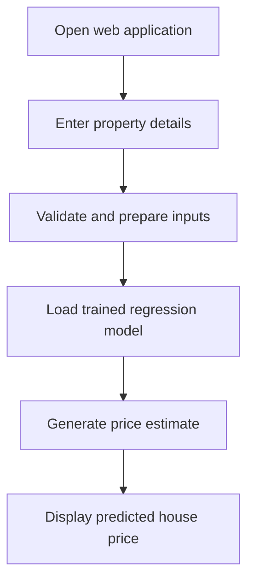

# 🏡 House Price Prediction System

### Machine Learning • Regression • Python • Flask • Real Estate Analytics

[](https://www.python.org/)
[](https://flask.palletsprojects.com/)
[](https://scikit-learn.org/)
[](https://render.com/)

**[🚀 Live Demo](https://house-price-prediction-4-0adn.onrender.com/)** · **[💻 GitHub Repository](https://github.com/yashchaudhari372-lab/House-Price-Prediction)**

## 📌 Project Overview

**House Price Prediction System** is a machine learning-powered web application designed to estimate residential property prices based on property information. It demonstrates an end-to-end workflow: loading a trained regression model, accepting user inputs through a web interface, generating a price estimate, and displaying the result.

The project connects predictive analytics with a user-friendly Flask application, making regression-based estimates easier to explore.

> **Note:** Predicted values are estimates, not professional appraisals or guaranteed market prices.

## 🎯 Problem Statement

Property prices vary with numerous characteristics. Manual estimates can be inconsistent and time-consuming. This project explores how a trained machine learning regression model can help estimate prices from structured housing features.

## ✨ Key Features

- 🏠 **Property price estimation:** Generate an estimated house price from user-provided property details.
- 🤖 **Saved regression model:** Load the pre-trained model from `linear_model.pkl`.
- 🌐 **Web-based experience:** Access the prediction interface through a Flask application.
- ⚡ **Interactive prediction workflow:** Submit property details and view the model's output.
- ☁️ **Cloud deployment:** Access the hosted application through Render.

## 🛠️ Technology Stack

| Layer | Technology | Purpose |
|---|---|---|
| Programming | Python | Application and prediction logic |
| Machine learning | Serialized regression model (`linear_model.pkl`) | House-price estimation |
| Web framework | Flask | Web interface and server-side prediction |
| Model persistence | Pickle (`.pkl`) | Loading the trained model |
| Dependencies | `requirements.txt` | Installing required Python packages |
| Hosting | Render | Live application deployment |

> The model filename suggests a linear regression model; check the original training notebook or serialized estimator to confirm the exact algorithm and preprocessing steps.

## 🔄 Prediction Workflow



### Machine Learning Pipeline

The overall development process follows these stages:

1. **Data preparation:** Inspect housing records, address missing values, and prepare numerical or categorical features as needed.
2. **Feature engineering:** Select and transform the property attributes used by the estimator.
3. **Model training:** Train a regression algorithm to predict house prices.
4. **Model evaluation:** Compare predictions against actual prices on held-out test data.
5. **Model serialization:** Save the trained model to `linear_model.pkl`.
6. **Application integration:** Load the model in `app.py` and serve predictions through Flask.
7. **Deployment:** Publish the application on Render.

*The training stages describe the project workflow; the public repository currently provides the saved model and application rather than a full training notebook.*

## 📁 Repository Structure

```text
House-Price-Prediction/
├── app.py              # Flask application and prediction interface
├── linear_model.pkl    # Serialized trained regression model
├── requirements.txt    # Python dependencies
└── README.md           # Project documentation
```

## 🚀 Run Locally

### Prerequisites

- Python 3.x
- pip
- Git

### 1. Clone the repository

```bash
git clone https://github.com/yashchaudhari372-lab/House-Price-Prediction.git
cd House-Price-Prediction
```

### 2. Create and activate a virtual environment

**Windows:**

```bash
python -m venv .venv
.venv\Scripts\activate
```

**macOS / Linux:**

```bash
python3 -m venv .venv
source .venv/bin/activate
```

### 3. Install dependencies

```bash
pip install -r requirements.txt
```

### 4. Start the application

```bash
python app.py
```

Open the local URL printed in your terminal (often `http://127.0.0.1:5000/`). Enter the required property details and submit the form to obtain an estimate.

## 📊 Model Evaluation

This is a **regression** problem, so suitable evaluation metrics include:

| Metric | Description | Verified result |
|---|---|---|
| R² score | Proportion of target variance explained on test data | 66.87% |
| MAE | Average absolute prediction error | 49,036,905,155.72 |
| RMSE | Square root of average squared prediction error | 221,442.78 |

**Important:** No verified test-set scores are available in the published repository. Do not report an invented accuracy percentage or R² score. To document performance, evaluate the saved model on the original held-out test set using exactly the preprocessing used during training.

## 🌍 Live Demo

**Try the application:** https://house-price-prediction-4-0adn.onrender.com/

The hosted app may take a moment to wake up if the hosting service has been idle.

## 📸 Screenshots

Add screenshots of the input form and prediction results to make the project easier to review.

Suggested repository structure after adding screenshots:

```text
assets/
├── input-form.png
└── prediction-result.png
```

Then uncomment these lines after uploading the images:

<!--  -->
<!--  -->

## 💡 Use Cases

- Exploring machine learning applications in real estate
- Demonstrating regression and model deployment skills
- Building an interactive portfolio project
- Supporting preliminary, non-binding property price exploration

## 🔮 Future Enhancements

- Add verified R², MAE, and RMSE results from a reproducible test split.
- Publish the training notebook, feature descriptions, and dataset provenance.
- Provide model explanations and feature importance where supported.
- Add input validation, automated tests, and prediction confidence intervals where statistically justified.
- Compare multiple regression algorithms on the same test data.
- Include application screenshots and usage examples.

## 👨‍💻 Developer

**Yash Chaudhari**  
Aspiring Data Scientist & Data Analyst

- **GitHub:** https://github.com/yashchaudhari372-lab
- **LinkedIn:** https://www.linkedin.com/in/yashchaudhari08/

## ⭐ Support

If you find this project useful, consider starring the repository. Feedback and suggestions are welcome!

---

*This project is intended for educational and portfolio demonstration purposes. Predictions should not be used as the sole basis for financial or real-estate decisions.*
